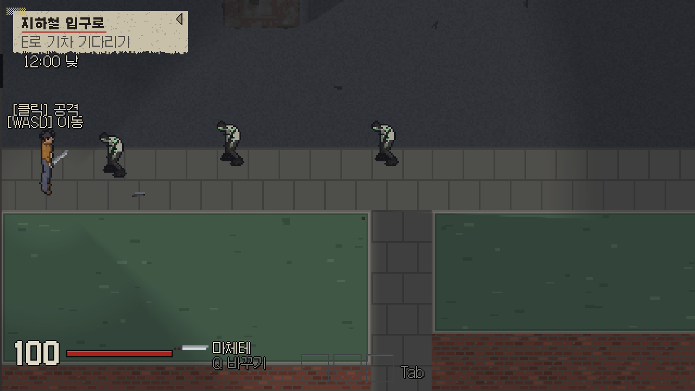
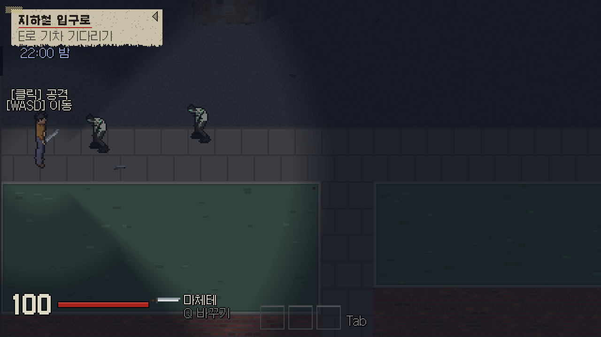

# 조사: 게임 분위기와 UI (2026-11-25)

요청: "게임의 분위기, UI적인 측면을 좀 조사를 해 보고 싶어". 계획서: [2026-11-25_분위기_UI_조사](../plans/2026-11-25_분위기_UI_조사.md).
먼저 읽은 것: [UI_NOT_AI_RESEARCH](UI_NOT_AI_RESEARCH.md)(11-16 UI 원칙 7가지 — 그대로 유효), [ART_STYLE_RESEARCH](../planning/ART_STYLE_RESEARCH.md), [ZOMBOID_VISUAL_REFERENCE](../planning/ZOMBOID_VISUAL_REFERENCE.md), [GAME_JUICE](GAME_JUICE_2026-11-20.md).
이번에 새로 본 것: **분위기**(어둠·빛·색·날씨·화면 효과)와 **총 중심 UI**(11-23 총이 주무기가 된 뒤 아직 없음).

표시: **[사실]** 출처에 적힌 것 · **[추정]** 개발 글·리뷰의 의견 · **[제안]** 우리 게임에 쓸 후보(사용자가 고름)

## 1. 지금 우리 화면 (숨긴 창, 낮 12시 · 저녁 18시 반 · 밤 22시)

(저녁: [mood_now_18.png](../planning/mood_now_18.png))

| 본 것 | 점검 |
|---|---|
| 낮·저녁·밤 | 밤이 **조금 어두워질 뿐** 낮과 거의 같다. 바라보는 쪽 시야가 옅게 밝을 뿐, 어둠이 무섭지 않다 |
| 색 | 회색 아스팔트·초록 풀밭 네모·벽돌. 색이 고르고 평평해서 **"핵 재난 한국"이 안 보인다**(간판·차·재·방사능 색 없음) |
| 공기 | 움직이는 것이 사람뿐. 바람·재·비·먼지 같은 **공기의 움직임이 없다** |
| UI 좋은 점 | 테이프 붙인 목표 쪽지(디제틱), 도트 글꼴, 왼쪽 아래 체력 큰 숫자 — 11-16 원칙대로 |
| UI 아쉬운 점 | **총 정보가 없다**(탄약·재장전·조준점). 조작 안내 글자가 주인공 머리 위에서 겹침. 빠른 칸 3개가 비어 있어도 늘 보임 |

## 2. 분위기를 만드는 법 (다른 게임에서)

### 2-1. 어둠과 시야 — "빈 곳을 상상하게"

- **Darkwood**(탑뷰 공포): [사실] 시야가 앞쪽 원뿔이고, 밝기는 시간·빛에 따라 달라진다. 원뿔 안에서만 적·물건이 보이고 가구·나무·문 같은 배경은 계속 보인다. 밤에는 **문이 열리고 가구가 움직이는데 무엇이 했는지는 안 보인다**. [추정] 분위기는 "빈 공간과, 그걸 채우려는 우리 머리"에서 나온다, 갑자기 놀래는 장면은 드물게. ([Epic Games](https://store.epicgames.com/news/darkwood-is-a-horror-masterpiece-viewed-from-an-atypical-perspective), [GamesRadar](https://www.gamesradar.com/darkwood-is-like-silent-hill-hotline-miami-and-the-metro-series-rolled-into-one))
- **Zero Sievert**(탑뷰 슈터, 방사능 숲): [사실] 보이는 것을 정하는 시야(안개)가 핵심. 적도 시야가 있어 건물 뒤로 돌거나 차 뒤에 숨으면 놓친다. ([PC Gamer](https://www.pcgamer.com/this-top-down-shooter-is-like-stalker-as-a-roguelike), [foro3d](https://foro3d.com/en/2026/mayo/zero-sievert-tecnicas-de-pixel-art-y-niebla-de-guerra-en-gamemaker.html))
- **Graveyard Keeper**: [사실] 안개 층 위로 지붕·나무 꼭대기만 보이게. ([Game Developer](https://www.gamedeveloper.com/programming/graveyard-keeper-how-the-graphics-effects-are-made))
- 우리: 시야 원뿔·피폭체 시야는 이미 있음(좀보이드 규칙). **밤의 어둠이 약해서** 그 장점이 안 산다.

### 2-2. 색 — 장소마다 정해진 팔레트

- [사실] Medium Rare: 장소(숲·마을·공장)마다 **팔레트를 정하고** 렌더를 그 팔레트로 "눌러"(포스터화) 통일. ([80.lv](https://80.lv/articles/how-medium-rare-uses-pixel-art-collages-to-evoke-dread-of-industrialized-cannibalism/))
- [추정] 채도 낮고 어두운 팔레트 = 우울·불안, 밝고 진한 색 = 편안. ([Game Developer](https://www.gamedeveloper.com/game-platforms/how-to-make-a-game-graphics-more-dramatic-take-pixel-games-as-example))
- **방사능의 색**: [사실] Fallout 3의 "병든 초록"은 썩음·병을 뜻하도록 일부러 고른 색. [추정] Fallout 4는 흐린 노란 방사능 안개로 "변해 버린 햇빛"을 표현. 반대로 Far Cry New Dawn은 분홍·보라 폐허 → 초록은 관례일 뿐 규칙은 아님. ([Engadget](https://www.engadget.com/2015/11/13/fallout-4-color-palette/), [GamesRadar](https://www.gamesradar.com/games/fallout/fallout-3-went-hard-on-the-gloomy-despair-of-the-post-apocalyptic-world-to-differentiate-it-from-oblivion-but-one-dev-thinks-bethesda-went-too-far-we-just-drained-the-color-out-of-the-world), [USGamer](https://www.usgamer.net/articles/technicolor-dystopias-feature-colorful-wastelands-rage-2-far-cry-new-dawn-fallout-76))
- 우리 연결: 원거리 피폭체의 **목이 초록으로 빛남**(11-23 확정 방향)과 맞음 → "초록 = 피폭·위험"을 게임 전체 색 규칙으로 삼을 수 있음.

### 2-3. 화면 효과 — 적게, 이유 있게

- [사실] 가장자리 어둡게(비네트)로 시야를 좁히고, 어두운 곳에서 빛나는 색(블룸)을 띄움. 색 수 줄이기(LUT/포스터화), 은은한 빛·색 번짐(색수차)으로 단순한 도트에 질감. ([Paranormal Pursuit 개발 글](https://aleronf.itch.io/kit109/devlog/720557/devlog-6-lighting-and-post-processing), [Raid30](https://dralketh.itch.io/raid30/devlog/406813/turning-basic-pixel-art-into-satisfying-visuals))
- [추정] 공포의 목표는 놀람보다 **불안(dread)**, 도트는 잔인함을 누그러뜨려 다루기 쉽게 해 줌. ([80.lv](https://80.lv/articles/how-medium-rare-uses-pixel-art-collages-to-evoke-dread-of-industrialized-cannibalism/), [Xbox Wire](https://news.xbox.com/en-us/2025/09/12/lo-fi-visuals-in-modern-horror-gaming/))

## 3. UI (총 중심)

- **탄약 수는 세상 안/커서 근처가 낫다**: [사실] 연구(GEM 2015)에서 세상 안 숫자 표시가 아이콘 HUD보다 나았다 — 탄이 떨어진 뒤 헛방이 35% 적고 재장전이 26% 빠름. 후속 연구: **탄약은 세상 안/공간 표시, 체력은 HUD**가 가장 좋았다. ([GEM2015 논문](https://www.csit.carleton.ca/~rteather/pdfs/GEM2015_HUDs.pdf), [York U](https://www.yorku.ca/mack/ieee_gem2015.html), [EC2018](https://www.yorku.ca/mack/ec2018.html))
- [추정] 커서 옆 탄약은 조준점보다 **덜 밝고 다른 색**이어야 거슬리지 않음. 재장전 중에는 탄약 숫자에 **남은 시간 막대**(플레이 시험에서 요청된 기능). ([itch.io 토론](https://itch.io/post/337702), [Bloody Battlegrounds 개발 글](https://hovr.itch.io/bloody-battlegrounds/devlog/617044/polish-and-ui))
- [추정] 계속 보는 정보(체력)는 모서리, 순간 정보(조준점·안내)는 가운데. ([StraySpark](https://www.strayspark.studio/blog/game-ui-ux-design-principles))
- **맞은 방향·화면 밖 위협**: [추정] 탑뷰는 적이 대부분 보여서 방향 표시가 덜 필요. 화면 밖 위협은 **가장자리 화살표**가 흔한 방법. ([Signals and Light](https://signalsandlight.substack.com/p/how-do-enemy-attacks-work-with-the), [Tuts+](https://code.tutsplus.com/positioning-on-screen-indicators-to-point-to-off-screen-targets--gamedev-6644t))
- **최소 HUD**: [추정] The Long Dark는 10개 넘는 상태를 몰입을 깨지 않고 보여 주는 최소 UI로 호평, 진행 막대가 많은 건 비판. 좀보이드는 상태 아이콘(무들)을 오른쪽 위에 — 도트 아이콘을 고해상도로 바꾸자 "도트 매력이 사라졌다"는 반응. ([Game Developer](https://gamedeveloper.com/design/long-dark-survival-game-hud-ui), [PC Gamer](https://pcgamer.com/the-long-dark-review), [bisecthosting](https://www.bisecthosting.com/blog/project-zomboid-moodles-status-effects-pictures-icons-faces-moods))

## 4. 우리 게임에 쓸 후보 [제안] — 사용자가 고름

| # | 후보 | 무엇 | 맡을 쪽 | 크기 |
|---|---|---|---|---|
| A | **밤을 진짜 어둡게 + 빛** | 밤엔 화면 대부분 어둡고, 시야 원뿔·가로등·불 붙은 차만 밝음. Darkwood처럼 원뿔 밖 소리·움직임만 들림 | Claude(빛 계산·점검) | 중간 |
| B | **장소별 팔레트 + 시간대 색** | 골목·역 등 장소마다 색 묶음, 낮은 바랜 회색, 저녁은 주황, 밤은 푸른 회색. 초록은 피폭·위험에만 | GPT(팔레트·분위기 시안) → Claude(적용) | 작음~중간 |
| C | **공기 움직임** | 떠다니는 재(방사능 낙진), 가끔 비, 바람에 날리는 종이 | Claude(입자) | 작음 |
| D | **가장자리 어둡게(비네트) + 맞았을 때 강하게** | 평소 은은히, 체력 낮으면 진해지고 심장 소리 | Claude | 작음 |
| E | **총 UI: 커서 옆 탄약 + 재장전 막대** | 조준점 옆에 작게 탄약 수(덜 밝은 색), 재장전 중 막대, 탄이 없으면 깜빡 + 빈 소리 | Claude(+GPT 조준점·아이콘 그림) | 작음 |
| F | **한국·피폭 소품** | 한글 간판, 버려진 차, 방사능 경고 표지, 피난 안내문 — "어디인지" 보이게 | GPT(소품 그림) → Claude(배치) | 중간 |
| G | **화면 밖 위협 화살표** | 화면 밖 원거리 피폭체가 쏠 때만 가장자리에 초록 화살표 | Claude | 작음 |
| H | **조작 안내 정리** | 머리 위 겹치는 안내를 처음 몇 번만, 빈 빠른 칸은 숨김 | Claude | 작음 |

제 추천 순서: **E(총 UI)** → **A(밤의 어둠)** → **C·D(공기·가장자리)** → **B·F(색·소품, GPT와 함께)**. E는 총이 주무기가 된 지금 바로 필요하고, A는 시야·소리 규칙이 이미 있어 효과가 큼.

## 5. 출처 목록

[Epic Games — Darkwood](https://store.epicgames.com/news/darkwood-is-a-horror-masterpiece-viewed-from-an-atypical-perspective) · [GamesRadar — Darkwood](https://www.gamesradar.com/darkwood-is-like-silent-hill-hotline-miami-and-the-metro-series-rolled-into-one) · [PC Gamer — Zero Sievert](https://www.pcgamer.com/this-top-down-shooter-is-like-stalker-as-a-roguelike) · [foro3d — Zero Sievert](https://foro3d.com/en/2026/mayo/zero-sievert-tecnicas-de-pixel-art-y-niebla-de-guerra-en-gamemaker.html) · [Graveyard Keeper effects](https://www.gamedeveloper.com/programming/graveyard-keeper-how-the-graphics-effects-are-made) · [80.lv — Medium Rare](https://80.lv/articles/how-medium-rare-uses-pixel-art-collages-to-evoke-dread-of-industrialized-cannibalism/) · [Game Developer — dramatic pixel graphics](https://www.gamedeveloper.com/game-platforms/how-to-make-a-game-graphics-more-dramatic-take-pixel-games-as-example) · [Paranormal Pursuit devlog](https://aleronf.itch.io/kit109/devlog/720557/devlog-6-lighting-and-post-processing) · [Raid30 devlog](https://dralketh.itch.io/raid30/devlog/406813/turning-basic-pixel-art-into-satisfying-visuals) · [Xbox Wire — lo-fi horror](https://news.xbox.com/en-us/2025/09/12/lo-fi-visuals-in-modern-horror-gaming/) · [Engadget — Fallout 4 palette](https://www.engadget.com/2015/11/13/fallout-4-color-palette/) · [GamesRadar — Fallout 3 colour](https://www.gamesradar.com/games/fallout/fallout-3-went-hard-on-the-gloomy-despair-of-the-post-apocalyptic-world-to-differentiate-it-from-oblivion-but-one-dev-thinks-bethesda-went-too-far-we-just-drained-the-color-out-of-the-world) · [USGamer — colourful wastelands](https://www.usgamer.net/articles/technicolor-dystopias-feature-colorful-wastelands-rage-2-far-cry-new-dawn-fallout-76) · [GEM2015 HUD study](https://www.csit.carleton.ca/~rteather/pdfs/GEM2015_HUDs.pdf) · [York U GEM2015](https://www.yorku.ca/mack/ieee_gem2015.html) · [York U EC2018](https://www.yorku.ca/mack/ec2018.html) · [itch.io ammo UI](https://itch.io/post/337702) · [Bloody Battlegrounds devlog](https://hovr.itch.io/bloody-battlegrounds/devlog/617044/polish-and-ui) · [StraySpark UI principles](https://www.strayspark.studio/blog/game-ui-ux-design-principles) · [Signals and Light](https://signalsandlight.substack.com/p/how-do-enemy-attacks-work-with-the) · [Tuts+ offscreen indicators](https://code.tutsplus.com/positioning-on-screen-indicators-to-point-to-off-screen-targets--gamedev-6644t) · [Game Developer — The Long Dark HUD](https://gamedeveloper.com/design/long-dark-survival-game-hud-ui) · [PC Gamer — The Long Dark](https://pcgamer.com/the-long-dark-review) · [Project Zomboid moodles](https://www.bisecthosting.com/blog/project-zomboid-moodles-status-effects-pictures-icons-faces-moods)
