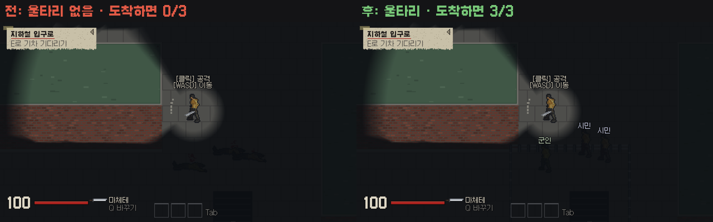
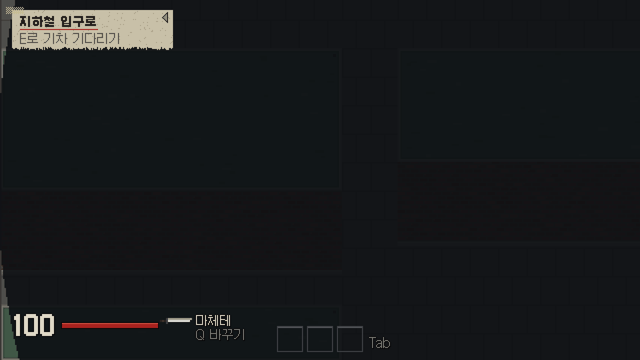

# 01. 역에 갔더니 다 죽어 있었다



## 무슨 일이 있었나

역 디펜스를 만들고 해 보니, 물자를 챙겨 역에 도착하면 **지켜야 할 군인과 시민이 이미 다 쓰러져 있었다.** 디펜스를 시작하기도 전에 끝난 셈이다.



범인은 같은 날 넣은 두 규칙이었다.

- 피폭체는 **가장 가까운 사람**을 노린다. 주인공이 멀리서 물자를 줍는 동안, 역 근처를 지나던 피폭체에게는 시민이 가장 가까웠다.
- 군인은 **보이면 쏜다.** 그런데 총소리(400)는 피폭체를 부른다. 군인이 쏠 때마다 피폭체가 역으로 더 모였다.

각각은 맞는 규칙인데, 합쳐지니 "주인공이 오기 전에 역이 무너지는" 상황이 됐다. 게임 AI에서 자주 생기는 일이다. **규칙끼리 부딪혀서 생기는 문제는 하나씩 볼 때는 안 보인다.**

## 어떻게 막을까

떠오른 방법은 네 가지였다.

| 방법 | 한 줄 평가 |
|---|---|
| 맵에 진짜 벽을 그린다 | 디펜스 때 벽을 치우고 길 찾기도 다시 계산해야 해서 무겁다 |
| **피폭체만 못 들어가는 구역** | 주인공은 지나가고 피폭체만 막힌다. 켜고 끄기가 쉽다 ✔ |
| **디펜스 전엔 사람들을 노리지 않게** | 한 줄이면 된다. 하지만 이것만 하면 그냥 걸어 들어온다 ✔ |
| 디펜스를 시작할 때 사람들을 만든다 | 안전하지만 "사람들이 기다리는 역"이라는 느낌이 사라진다 ✘ |

두 번째와 세 번째를 같이 썼다. 구역만 막으면, 울타리 밖 피폭체가 안의 시민을 보고 울타리에 붙어 기다리다가 디펜스를 시작하자마자 덮친다. 군인도 디펜스 전엔 쏘지 않게 했다. 총소리가 피폭체를 부르니까.

그리고 **E를 누르는 순간** 세 가지가 한꺼번에 풀린다. 울타리가 열리고, 피폭체가 사람들을 노리기 시작하고, 군인이 사격을 시작한다.

## 핵심 한 가지

> **출입 금지 구역 (Keep-out zone)**: 길이나 이동에서 특정 영역을 "이 무리는 못 들어감"으로 표시하는 방법.

언리얼 엔진의 *Nav Modifier Volume*, 유니티의 *NavMesh Obstacle*이 같은 생각이다. 상점가 NPC가 가게 안에 못 들어오게 하거나, 보스방 문이 닫히는 연출도 대부분 이 방식이다.

우리 코드에서는 아주 작다. 몸마다 "들어가면 안 되는 사각형" 목록을 들고 있고, 걸음을 옮기기 전에 그 안으로 들어가는 걸음인지 확인한다. 주인공은 목록이 비어 있어서 그대로 지나간다. 이미 안에 있는 몸은 나갈 수 있게 해서, 갇혀 멈추는 일이 없다.

```python
# src/area.py
def kept_out(body, x, y):
    for l, b, r, t in getattr(body, "keep_out", ()):
        if l <= x <= r and b <= y <= t and not (l <= body.x <= r and b <= body.y <= t):
            return True          # 밖에서 안으로 들어가려는 걸음만 막는다
    return False
```

목록은 피폭체 하나하나가 아니라 `Zombie` 클래스 하나에 둔다. 나중에 생기는 피폭체도 자동으로 막히고, 열 때도 `Zombie.keep_out = []` 한 줄이면 된다.

## 무거울까?

아니다. 사각형 안인지 숫자 네 번 비교하는 게 전부고, 움직이는 몸만 검사한다. 구역이 수십 개로 늘어나면 벽에 쓰는 방식처럼 근처 구역만 보게 바꾸면 되지만, 지금은 하나라서 하지 않았다. **필요해지기 전엔 최적화하지 않는다.**

## 숫자로 확인

주인공을 멀리 두고 90초를 기다렸다가 역에 가 봤다.

- 울타리 없음: 6초 만에 첫 공격, 도착하면 **0/3**
- 울타리 있음: 네 번 돌려서 네 번 모두 **3/3**, 울타리 안에 들어온 피폭체 0

## 아직 남은 것

길 찾기는 울타리를 모른다. 피폭체가 울타리 너머로 가야 할 일이 생기면, 돌아가지 않고 울타리 앞에서 미끄러지기만 한다. 지금은 디펜스 전엔 갈 이유가 없어서 괜찮다. 나중에 필요해지면 길 찾기 격자에 구역을 넣는다.

울타리 그림도 임시다. 진짜 역 셔터가 올라가는 연출로 바꾸면 좋겠다.

---
코드: `src/area.py` `kept_out`, `move_body` · `src/infected.py` `Zombie.keep_out` · `src/play.py` `start_defense`, `prey_for`, `update_people`, `draw_fence`
