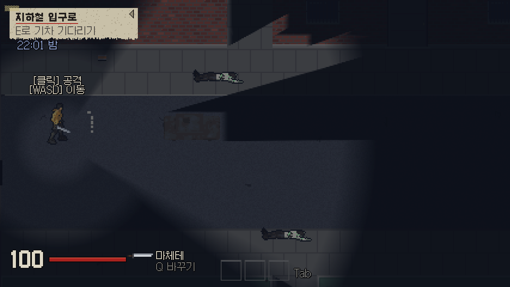

# 02. 우리 게임의 시야: 기법 다섯 개를 합친 것 (2026-11-18)

「부산까지」의 "눈앞만 보인다"는 기법 하나가 아니라 다섯 개가 겹쳐서 만들어진다. 주인공이 보는 쪽과 피폭체가 보는 쪽은 따로 있다.

## 주인공이 보는 것

### 1. 시야 원뿔 (Vision cone / Field of view)

바라보는 방향(마우스 쪽)을 가운데로 좌우 약 40도, 정해진 거리까지만 보인다. 점 하나가 보이는지는 두 가지만 묻는다.

- 거리: `hypot(dx, dy)` 가 시야 길이 안인가
- 각도: `atan2(dy, dx)` 로 그 점의 방향을 구하고, 바라보는 방향과의 차이가 40도 안인가

경계는 칼로 자르지 않고 조금씩 흐려지게 한다(각도 0.16라디안, 거리 50에 걸쳐). 시야 길이는 **낮 520, 밤 300**이고 저녁·새벽에 서서히 바뀐다(`daylight.py`).

코드: `vision_cone.alpha_at`

### 2. 시야 막힘 = 광선 쏘기 (Line of sight / Raycasting)

시야 안이어도 벽이나 차 뒤는 안 보인다. 눈에서 그 점까지 **광선**을 쏴서, 그 사이에 장애물(사각형)이 있으면 막힌 것이다. 사각형과 광선이 만나는지는 **슬랩(slab) 방식**으로 구한다: 가로 방향으로 사각형을 지나는 구간과 세로 방향으로 지나는 구간을 각각 구해서, 두 구간이 겹치면 맞은 것이다.

우리 게임은 그림자를 장애물의 **뒷면**에서 시작하게 한다. 벽 자체는 앞에서 보이니까.

코드: `vision_cone.ray_hit`

### 3. 가시성 다각형과 모서리 광선 (Visibility polygon)

화면 전체를 어둡게 칠할 때 픽셀마다 광선을 쏘면 너무 느리다(한 화면 23만 픽셀). 그래서:

1. 발에서 사방으로 빛줄기를 쏜다(고르게 96개).
2. 줄기마다 처음 부딪히는 곳까지의 거리를 잰다.
3. 이웃한 줄기의 끝점을 이어 **삼각형**으로 채운다.

이렇게 이어 붙인 모양이 **가시성 다각형**이다. 안은 보이고 밖은 안 보인다.

문제는 3번이다. 한 줄기는 장애물을 비켜 가서 멀리 가고, 바로 옆 줄기는 장애물에 맞아 짧게 끝나면, 삼각형이 두 끝을 직선으로 이어 그림자 속을 비스듬히 가로지른다. 그래서 그림자 경계가 번진다. 줄기 간격은 각도라서 멀수록 더 번진다.

**해결:** 그림자의 경계는 언제나 장애물의 **모서리**에서 생긴다. 그러니 가까운 장애물마다 네 모서리 방향을 구해 그 **바로 왼쪽과 오른쪽**(±0.002라디안)으로 줄기를 더 쏜다. 한쪽은 모서리를 스치며 맞고, 다른 쪽은 비켜 간다. 둘 사이 삼각형이 아주 가늘어져서 경계가 모서리에 딱 맞는다.

- 줄기 수가 매번 달라지므로, 마지막 줄기를 첫 줄기와 같게 한 번 더 넣어 고리를 닫는다. 그러면 "이웃한 줄기 a, a+1끼리 삼각형"이라는 순서가 늘 같아서, 삼각형 번호표를 처음에 한 번만 만든다.
- 시야 밖 모서리는 건너뛴다. 시야 밖은 그림자든 아니든 같은 어둡기로 그려서 화면에 차이가 없기 때문이다.
- 한 줄기 위에서는 방향이 안 바뀌니 각도 계산은 줄기마다 한 번만 한다.

결과: 그림과 계산이 어긋나는 곳 1.54% → 0.06~0.07%, 한 프레임 11~12ms(60fps 안).

더 보기: Red Blob Games "2D Visibility" (끌어서 움직여 보는 설명), 섀도 캐스팅(shadow casting), 로그라이크의 FOV(칸 단위로 같은 문제를 푸는 법).

코드: `vision_cone.VisionCone.draw`

### 4. 정점마다 어둡기 (Per-vertex alpha mesh)

어둠은 검은 삼각형 그물 하나로 그린다. 삼각형의 꼭짓점마다 어둡기(투명도)를 정하면, 그래픽 카드가 꼭짓점 사이를 부드럽게 섞어 준다. 시야 경계, 몸 주변 원, 그림자 경계가 모두 이것으로 부드러워진다. SDL2의 `SDL_RenderGeometry` 를 직접 부른다(pico2d에는 없는 기능).

### 5. 보이는 것과 그려지는 것을 나누기 (Fog of war의 방식)

처음엔 어둠 하나가 두 일을 다 했다. 화면을 칠하는 일과, 일정 이상 어두우면 피폭체를 숨기는 일이다. 그래서 낮에 어둠을 옅게 하면 피폭체까지 보였다.

지금은 나눴다.
- **보이는가(규칙):** 늘 가장 어두운 값으로 판정한다. 시야 밖·벽 뒤의 피폭체는 낮에도 안 보인다. `vision.visible()`
- **어떻게 그리나(분위기):** 세상은 살짝만 어둡게(낮 60, 밤 150 + 푸른빛). 거리와 건물은 늘 보인다. `vision.darkness(..., drawn=True)`

전략 게임의 **전장의 안개(fog of war)**와 같은 생각이다. 지형은 보이고, 적은 내 시야 안에서만 보인다.

### 덤: 몸 주변 원 (Proximity awareness)

몸에서 120까지는 반쯤만 어둡다. 등 뒤라도 바로 옆에 있는 피폭체는 보인다. 사람이 가까운 기척은 느끼는 것처럼.

## 피폭체가 보는 것 (따로 있음)

피폭체도 같은 원리로 주인공을 본다. 바라보는 방향 좌우 63도 안, 140 안이고, 사이에 벽이 없으면 "!"가 뜬다(`infected.sees`). 등 뒤라도 36 안이면 본다. 소리는 시야와 따로 원으로 퍼진다(`play.make_noise`). F5가 피폭체의 시야, F6이 소리다.

## 겪은 일

그림자가 이상하다는 지적을 두 번 받았다. 계산은 처음부터 맞았는데 **그림이 계산과 달랐다.** 어둠을 가슴 높이(22 위)에서 그려 모든 그림자가 위로 밀려 있었고, 줄기 사이가 번졌고, 지도의 표시 밑에 밝은 칸이 그려져 있었다. 이제는 "그려진 것"을 흰 바탕에 따로 그려 계산과 픽셀 단위로 비교하는 점검(`check_shadow_match`)을 돌린다.
