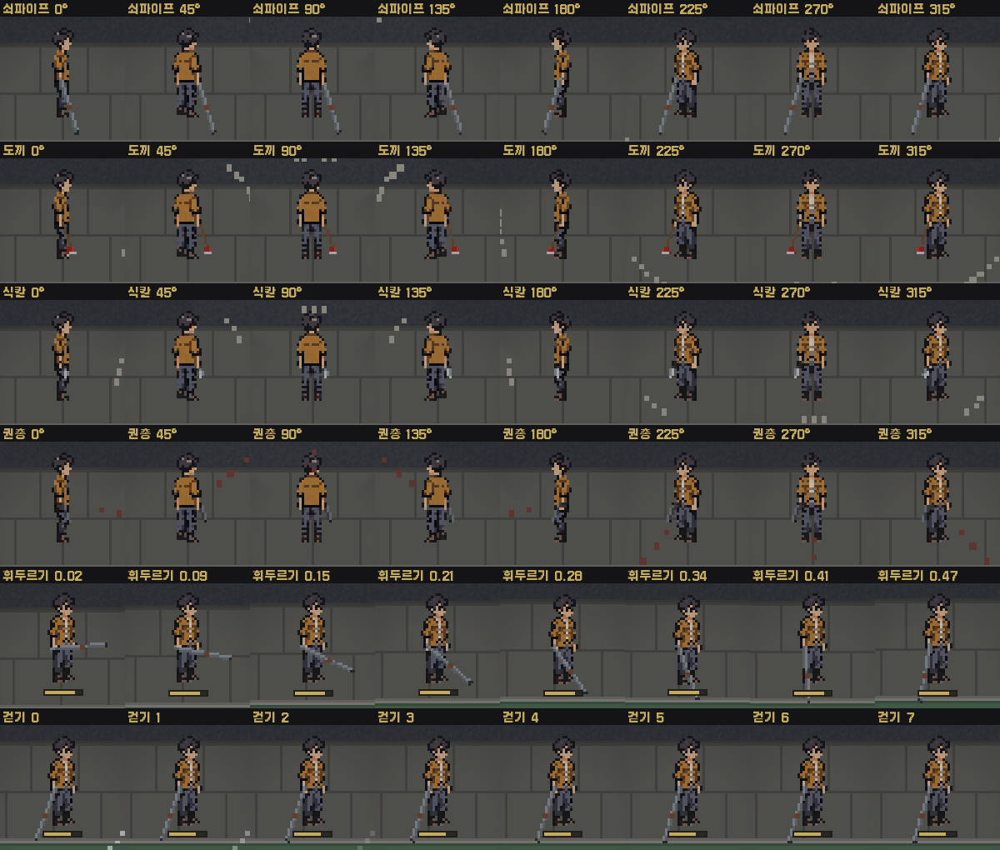

# 03. 무기를 바꿀 때마다 그림을 다시 뽑을 수는 없다: 레이어 그리기 (2026-11-19)

새 주인공은 PixelLab으로 뽑는다. 그런데 무기 다섯 개와 권총, 나중의 칼날 팔까지 들 때마다 8방향 × 동작마다 새로 뽑으면, 모습 하나에 무료 사용분 50회쯤이 든다. 사용자 질문: "무기를 들면 또 그걸 만들어야 하는데, 그럴 때마다 스프라이트를 다시 만들어야 하나?"

## 어떻게 풀었나

| 나눈 것 | 만드는 곳 | 몇 벌 |
|---|---|---|
| 몸 (빈손) | PixelLab | 1벌 |
| 무기 그림 | `assets/weapons/<무기>.png` | 무기마다 1장 |
| 손 위치 | `find_hands.py`가 자동으로 찾음 | 프레임마다 점 1개 |

게임은 매 프레임 몸을 그리고, 그 프레임의 손 점에 무기 그림을 붙인다. 무기 그림의 손잡이(왼쪽 끝에서 2px)가 손 점에 오도록 각도만큼 돌려서 그린다.

## 핵심 한 가지: 부착점 (Attachment point · socket · paper doll)

종이 인형에 옷을 갈아입히듯, 몸 위에 다른 그림을 겹친다. 겹칠 자리는 **부착점**이라는 점 하나로 정한다. 3D 게임의 "소켓(socket)"도 같은 생각이다(손 뼈에 무기를 붙임).

- **손은 어떻게 찾나:** 주인공은 소매를 걷어 팔뚝이 피부색이다. 몸 아래쪽 40~78% 높이에서 피부색 픽셀을 찾고, 가장 낮은 덩어리가 손이다(78% 아래는 갈색 부츠가 피부처럼 보여서 뺀다). 남쪽을 볼 때는 그림 왼쪽이 오른손, 북쪽을 볼 때는 오른쪽. 손이 몸에 가린 프레임은 가까운 프레임의 점을 쓴다. 틀리면 `hands_fix.json`으로 고친다.
- **앞뒤 순서:** 등을 보일 때(북·북동·북서)는 무기를 몸보다 먼저 그려서 몸 뒤에 있게 한다.
- **휘두르기:** 휘두르는 그림이 아직 없어서, 몸은 서 있는 채로 무기만 손을 축으로 돌린다. 내려치기는 겨눈 방향 +60°에서 −60°로, 맞는 순간에 끝에 닿는다. 찌르기는 6px 앞으로 갔다가 돌아온다.

## 숫자로 확인

`check_paperdoll`: 무기를 뺀 화면과 비교해 무기 픽셀만 골라낸 뒤, 손 점에서 가장 가까운 무기 픽셀까지의 거리를 쟀다. 8방향 중 7방향이 0.1~0.3 캔버스 픽셀. 북서쪽(1.3)은 몸 뒤로 그려져 손잡이가 몸에 가린 것(앞뒤 순서가 맞다는 뜻). 한 프레임 7.9ms.

## 약점과 남은 것

- 도끼도 칼도 같은 팔 동작이다. 무게에 따라 자세가 달라지는 건 표현하지 못한다.
- 서 있는 몸으로 무기만 돌리면 휘두르기가 가볍다. PixelLab 빈손 휘두르기 그림을 뽑으면 손 점도 따라간다(같은 도구).
- 권총은 늘어뜨리면 바지에 묻혀 잘 안 보인다. 총은 들고 있을 때 앞을 겨누게 하는 게 나을 수 있다.
- 칼날 팔도 오른손에 붙는 "무기"로 그리면 변이용 몸 그림 없이 된다.

코드: `src/character_look.py` `DirLook`, `draw_weapon` · `tools/sprites/find_hands.py`
