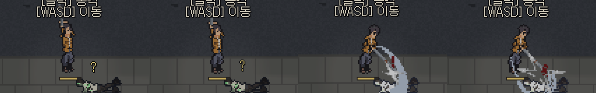

# 04. 스프라이트와 뼈대(Spine): 우리는 뼈대로 만들고 그림으로 굽는다 (2026-11-19)

사용자 질문: "방식이 스프라이트가 있고 스플린(스파인)이 있다고 하던데."

## 두 방식

| | 스프라이트(프레임) | 뼈대(Spine, DragonBones) |
|---|---|---|
| 만드는 법 | 장면마다 그림 한 장, 넘겨 보이기 | 그림을 조각으로 나누고 뼈를 심어, 뼈를 움직이면 조각이 따라감 |
| 그림 수 | 동작 × 방향 × 무기만큼 늘어남 | 한 벌 |
| 잘 맞는 그림 | 도트 | 고해상도 카툰 |
| 약점 | 그림이 많이 듦 | 도트를 돌리면 계단·이음새가 보임, 게임에 전용 실행기가 필요 |

## 핵심 한 가지: 뼈대로 만들고 그림으로 굽기 (bake)

우리 동작 만들기 사이트(`tools/animator`)는 뼈대 방식이다. 조각 나누기, 관절, 뼈 각도대로 돌리기까지 Spine과 같다. 다만 게임에서 실시간으로 돌리지 않고 **미리 프레임 그림으로 구워 둔다.** 그래서 pico2d는 그림 넘기기만 하면 되고 전용 실행기가 필요 없다.

- 뼈 각도는 Blender의 3D 동작을 그 방향 카메라로 본 관절 위치에서 온다(`export_pose2d.py --turn`).
- "서 있기에서 움직인 만큼만" 더해서 첫 프레임이 원래 그림과 똑같다.
- 도트를 돌리면 깨지는 약점은 RotSprite식 회전, 합친 뒤 정리(구멍·외곽선), 그리고 AI로 다시 그리기(A: PixelLab 뼈대 그리기, B: 내 컴퓨터 Stable Diffusion + ControlNet)로 보완한다.

## 더 보기

Spine(Esoteric Software, 유료), DragonBones(무료), 엔진의 Skeleton2D, RotSprite(도트 회전 알고리즘).

코드: `tools/animator/index.html`, `tools/blender/export_pose2d.py`, `tools/sprites/pixellab_skeleton.py`, `tools/ai/redraw_pose.py`
