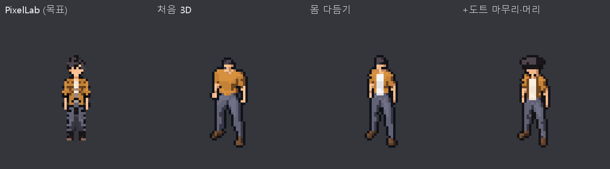

# 05. 3D를 도트로: 렌더만 하면 도트가 아니다 (2026-11-20)

사용자: "도트로 바꿀 때는 시중에 있는 그림들을 보고 학습해서 더 퀄리티가 높게."

## 이야기

Dead Cells는 캐릭터를 3D로 만들고 동작을 붙인 뒤, 아주 작은 크기로 부드럽게 하지 않고(안티에일리어싱 없이) 렌더해서 프레임마다 도트 그림을 얻었다. 손으로 매 프레임을 그리지 않아도 되는 게 핵심이었다. 그런데 작게 렌더한 그림이 곧 좋은 도트는 아니다. 사람이 그린 도트와 나란히 놓으면 차이가 바로 보인다.

## 핵심 한 가지: 도트 화가가 손으로 하는 일을 규칙으로 옮기기

도트 화가들이 쓰는 기본 기법을 렌더 뒤 정리 단계(`tools/sprites/repaint.py`)에 넣었다.

- **빛을 몇 단계로 자르기(셀 셰이딩):** 밝기를 연속값이 아니라 3단계로 끊는다. 이미 하던 것.
- **색 고르기:** 셔츠를 회색이 아니라 따뜻한 흰색으로, 외곽선을 순검정이 아니라 보랏빛 검정으로. 둘 다 PixelLab 주인공 그림에서 실제 픽셀 색을 뽑아 맞췄다.
- **안쪽 선(selective inner line):** 재킷이 셔츠와 만나는 가장자리에 재킷의 가장 어두운 색으로 1px 선. 검정 선이 아니라 그 부위의 어두운 색이라 부드럽다.
- **외톨이 픽셀 지우기:** 같은 부위 안에서 사방이 다른 한 색인 1px은 그 색으로. 렌더 잡음이 사라진다.
- **36px에서 읽히는 비율:** 실제 사람 비율이면 머리가 6px라 얼굴이 안 보인다. 도트 캐릭터는 머리를 크게(여기선 1.75배) 한다.

## 더 보기

셀/툰 셰이딩, 셀렉티브 아웃라인(sel-out), 색상 이동(hue shifting: 그늘은 푸르게, 빛은 노랗게), 필로우 셰이딩(피할 것), 클러스터. 다음에 해 볼 것: 깊이·법선으로 안쪽 윤곽선 찾기(t3ssel8r 방식), 그늘 색에 색상 이동 넣기.

출처: [80.lv Dead Cells 캐릭터 파이프라인](https://80.lv/articles/case-study-dead-cells-character-art-pipeline), [Lospec 외곽선 2부: 색 쓰기](https://lospec.com/articles/pixel-art-outlines-part-2-using-color), [Pixelizing 3D objects](https://medium.com/@elliotbentine/pixelizing-3d-objects-b55ec33328f1)

코드: `tools/sprites/repaint.py`(outline, inner_lines, cleanup), `tools/blender/costume.py`(open_front), `assets/characters/costumes/hero_px3d.json`
